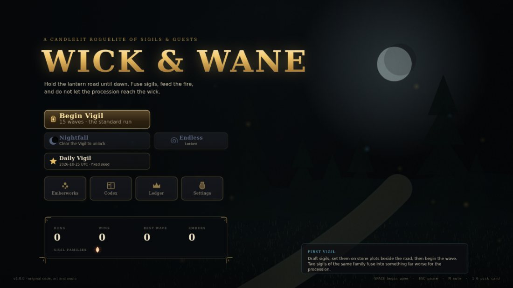
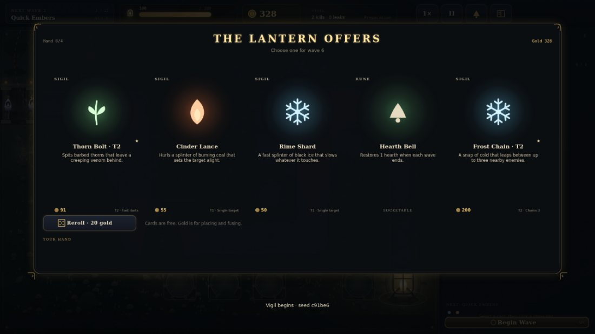
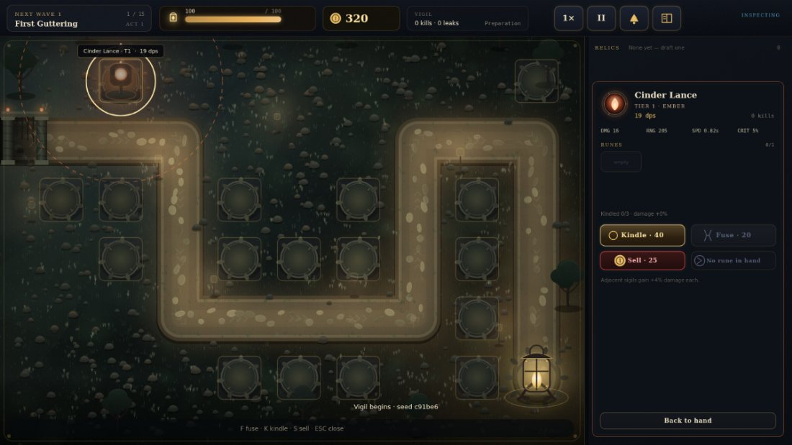
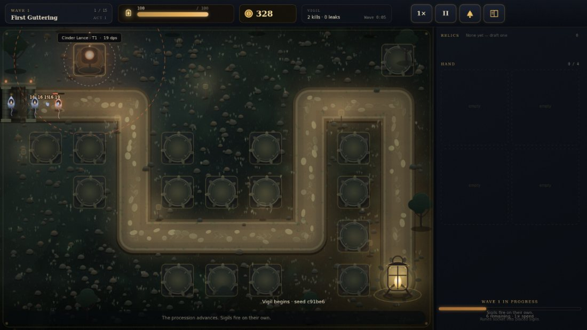
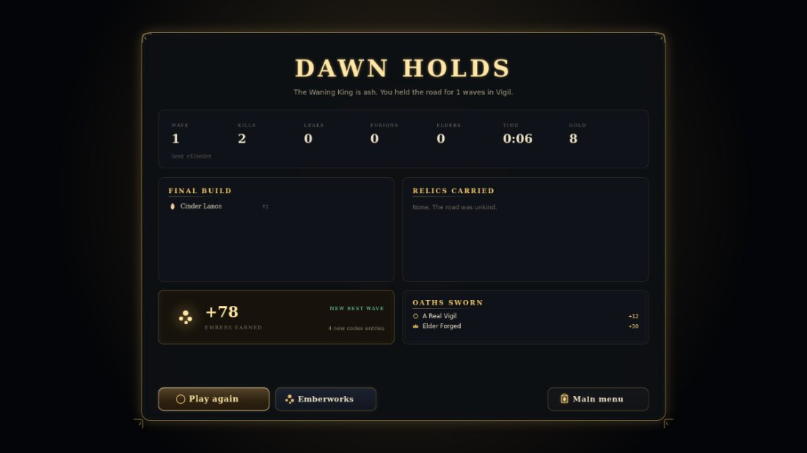

# Wick & Wane

**A candlelit roguelite of sigils & guests.**
An original 2D browser game: draft lantern sigils, plant them on stone plots beside the road, fuse them into Elders, and hold the procession back until dawn.



- **Play in the browser (GitHub Pages):** https://ritmirchic.github.io/Roblox/
- **Download the build:** https://github.com/Ritmirchic/Roblox/releases/download/v1.0.0/Wick_and_Wane_WEB.zip
- **Source:** https://github.com/Ritmirchic/Roblox

No install, no account, no external assets: every glyph, tower, enemy, particle and sound is generated in code at runtime.

---

## What you actually do

1. **Draft.** Each wave the lantern offers 3–5 cards: sigils, runes, relics or a gold cache. Cards cost nothing; choosing one is the whole loop.
2. **Place.** Drag a sigil from your hand onto one of 17 stone plots. Gold buys placement, fusions and kindling.
3. **Fuse.** Two sigils of the **same family and tier** become one sigil a tier higher; two tier‑3 sigils of a family become that family's **Elder**. This is how a run turns into a build.
4. **Socket.** Runes slot into tower sockets (tier and meta upgrades add sockets) to bend a sigil: pierce, chain, burn spread, range, crit.
5. **Survive.** 15 waves across 3 acts, 3 bosses, then optionally Endless. Leaks cost hearth; hearth at zero ends the vigil.
6. **Bank embers.** Every run pays embers even in defeat. Spend them in the Emberworks on permanent nodes and new sigil families.



## Content

| Thing | Count | Notes |
| --- | --- | --- |
| Sigil families | 5 | Ember (ignite), Frost (chill), Verdant (poison), Volt (shock/chains), Umbral (marks/execute). Later families unlock with embers. |
| Sigils | 15 | Bolt, splash, beam, pulse, field, chain, volley, support auras, execute, healer. |
| Elders | 5 | One per family, forged from two tier‑3 sigils. Run‑wide passives, not just bigger numbers. |
| Runes | 14 | Sockets only. Trade‑offs and sharpening. |
| Relics | 24 | Run‑wide modifiers drafted between waves. |
| Enemies | 13 | Wisps, coal mites, wax husks, moth pilgrims, root creepers, peat burrowers, shades, tallow warders, shriekers + 3 bosses with real mechanics (heal aura, splitting, shields, enrage). |
| Waves | 15 + ∞ | 3 acts, each with a boss; endless scaling afterwards. |
| Meta nodes | 16 | Including 4 family unlocks. |
| Achievements | 21 | Checked against run summaries; each pays embers. |
| Modes | 4 | Vigil (standard), Nightfall (harder, unlocked by clearing the Vigil), Endless (unlocked), Daily Vigil (fixed UTC seed). |

Screens: menu, Emberworks (meta upgrades), Codex (collection: sigils/elders/relics/runes/bestiary), Ledger (stats + achievements), Settings (volumes, damage numbers, screen shake, reduced motion, erase progress), run HUD, tower inspector, draft overlay, pause, victory/defeat results with build recap and earned embers.



## Controls

| Input | Action |
| --- | --- |
| Mouse / touch | Everything: cards, plots, buttons, sliders |
| `Space` | Begin the wave (in prep) |
| `1`–`6` | Pick the nth draft card / select the nth hand card |
| `F` | Fuse the inspected sigil, then click a partner |
| `K` | Kindle the inspected sigil |
| `S` | Sell the inspected sigil |
| `Esc` | Close inspector / cancel fusion / pause |
| `M` | Mute |
| `P` | Pause | 
| `1×`/`2×` HUD buttons | Game speed |

The game canvas is 1600×900 and letterboxes to any window; the layout scales, so it works at phone width in landscape as well as on a desktop.

## Systems, briefly

- **Draft economy.** Gold is spent on placement (`sigil cost`), fusion (20/45/85 by tier) and kindling (40·(1+0.7·rank), max 3 per tower, +15% damage and +6% speed each). Selling refunds 45%.
- **Resonance.** Orthogonally adjacent plots grant +4% damage each, so plot geometry matters.
- **Statuses.** Burn (damage over time, spreads), chill (slow), poison (stacking), shock (chain), mark (amplifies), root. Enemies resist some families, so a mono‑build has holes.
- **Enemy behaviours.** Healers, haste auras, splitting, armour auras, burrowing, shields and boss enrage, each on a timer.
- **Difficulty curve.** Enemy HP scales `1 + 0.105(w−1) + 0.009(w−1)²`, armour grows to a cap, Nightfall multiplies HP by 1.32.
- **Save.** `localStorage` under `wick-and-wane.save.v1`, versioned, sanitised on load: unknown nodes, fake achievements, impossible codex keys and hostile numbers are clamped or dropped, and a corrupt payload silently restarts the ledger (with a visible notice) instead of blocking the game.
- **Audio.** WebAudio only: synthesised drones, arpeggios and SFX with separate master/music/effects buses. Nothing autoplays before the first click, as browsers require; the context suspends when the tab is hidden.
- **Performance.** The board is baked once into an offscreen canvas; particles, floaters and glows are pooled; damage numbers are budgeted per frame; reduced-motion halves particle counts and disables shake.



## Tech

- TypeScript (strict, `noEmit`) + Vite 5, hand-rolled Canvas 2D renderer (no Phaser/Pixi dependency).
- No image, font or audio files: art is procedural canvas drawing, audio is synthesised oscillators and filtered noise, the UI uses system font stacks.
- Simulation is pure and headless-testable: `src/game/sim` never touches the DOM.

```
src/
  core/        math, rng, palette, save, audio
  game/
    data/      sigils, elders, runes, relics, enemies, meta, achievements, lore, schema
    sim/       map, draft, engine (all rules)
    render/    art (procedural drawing), fx (pooled particles), board (baked world)
  app/         ui widgets, screens, run screen, app shell, types
tests/         sim, save, app (UI-driven), visual, production-build smoke
tools/         preview renderers, release zip packer
```

## Testing (this is what was actually run)

```
npx tsc --noEmit      # strict typecheck: clean
npx vitest run        # 60 tests in 6 files: all pass
npm run build         # tsc + vite build -> docs/  (~204 kB JS, 66 kB gzip)
npm run zip           # reproducible release zip from a relative-path build
```

What the suite covers:

- **`tests/sim.test.ts`** — 27 tests: placement, costs, fusion (same family, tier ladder, elder forging, refusing cross-family), rune sockets, kindling, selling, statuses, armour/mark maths, wave director, leak → game over, abandoned-run summary, and headless full-run regressions on multiple seeds including Endless.
- **`tests/save.test.ts`** — round-trip, truncated JSON, non-object payload, newer save version, hostile numbers, unknown meta nodes, fake achievements/codex keys, storage that throws.
- **`tests/app.test.ts`** — 19 UI-driven tests through the real immediate-mode UI: menu → run, draft → placement → wave, pause blocking the simulation clock, speed control, Emberworks purchases and refusals, locked modes, achievement payout exactly once, reset progress, inspector fuse/kindle/sell, rune socketing, draft reroll/discard, keyboard picks, and a frame-budget smoke test.
- **`tests/visual.test.ts`** — renders every screen headlessly (`@napi-rs/canvas`) and writes PNGs to `artifacts/screens/`; this is how the art in this README was checked for layout regressions.
- **`tests/balance.probe.test.ts`** — plays 10 seeds headlessly with a scripted bot and prints the reachable wave depth (currently median wave 15, with both victories and late losses) plus a progression CSV, so balance changes are measurable rather than vibes.
- **`tests/build.smoke.test.ts`** — loads the **production bundle** from `docs/` into jsdom with a software canvas, asserts the boot overlay clears, the menu screen is live and 30 animation frames run without errors.

Honest gaps: there is no Playwright/Chromium in this environment (browser CDN downloads are blocked), so there is **no real-browser end-to-end or pixel-diff test**, and audio could not be listened to — WebAudio is exercised only for "does not throw when absent/blocked".

## Running locally

```bash
npm install
npm run dev        # http://localhost:5173
npm test           # vitest
npm run build      # production build into docs/
npm run zip        # artifacts/Wick_and_Wane_WEB.zip (relative paths, runs from a folder)
```

The zip is a static site: unzip it, then serve the folder with any static server (`npx serve`), or open `index.html` from a local server. Opening it via `file://` is blocked by browser module rules, not by the game.

## Design credits

Mechanics were studied from public design writing (roguelite upgrade cadence, tower‑defense wave pacing, between-round drafting, visible trigger sequencing). All names, characters, art, audio, text and code here are original to this project; nothing is copied from another game.



## Licence

MIT (see `LICENSE`).
