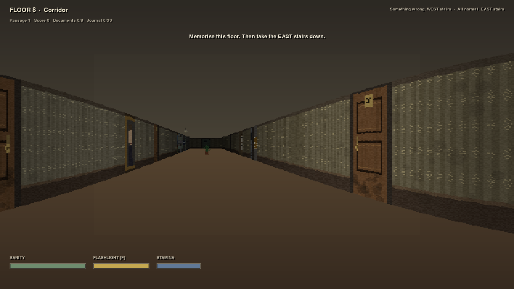
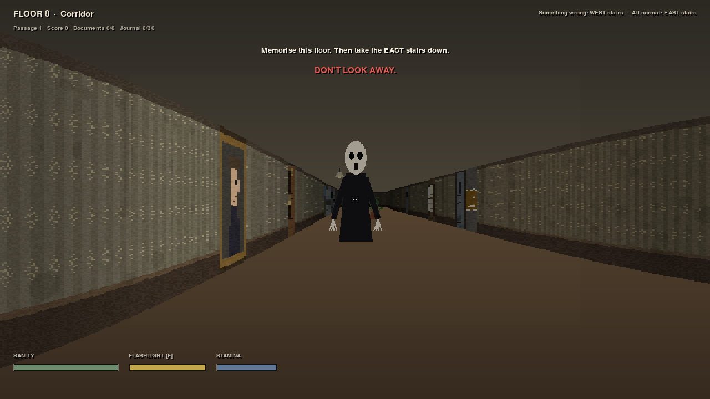
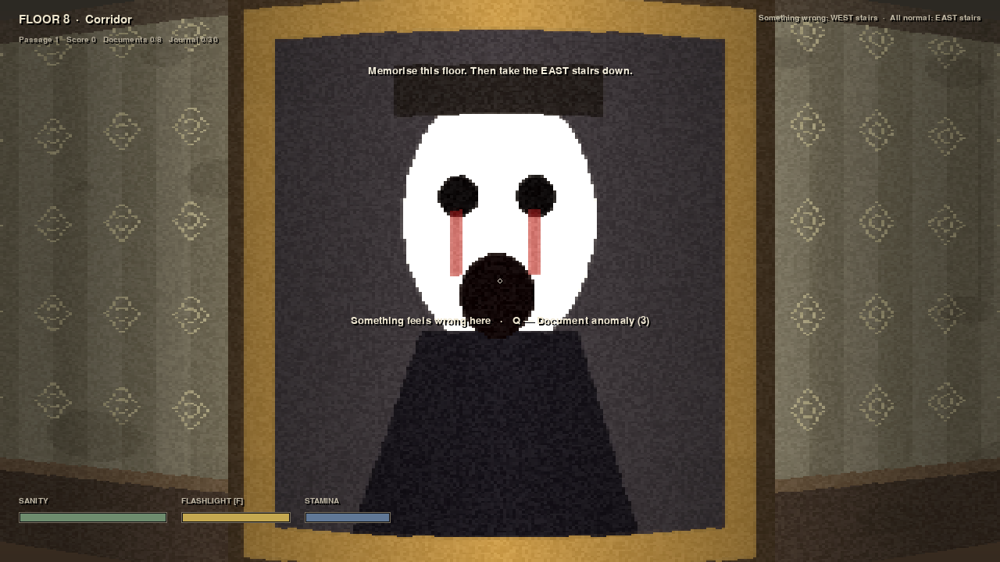

# DON'T LOOK BACK

**A psychological horror game about noticing.** You wake in Apartment 4B, Meridian House.
The floor looks normal — but every passage through it, something may have changed:
a painting, a sound, a door, a figure at the end of the corridor. Memorise the floor.
Document what is wrong. Then commit with your feet:

- **Something is wrong → WEST stairs** (go back / report it)
- **Everything is normal → EAST stairs** (go down)

Eight correct judgements take you from Floor 8 to the ground floor. Wrong judgements
cost sanity and send you back up. Lose your sanity, and the building keeps you — as furniture.





## Features

- **Complete apartment floor** — corridor, Apartments 4A/4B (living room, bedroom,
  bathroom)/4C, laundry room, storage, maintenance room, lift lobby, basement,
  stairwells, notice board, and a hidden **Room 0**. All doors functional.
- **30 fully implemented anomalies** (10 visual, 8 audio, 7 environmental, 5 entity),
  each with a real world/audio change, a detection/documentation target, gameplay
  consequences and reset behaviour. See the in-game Anomaly Journal.
- **Observation gameplay** — interaction prompts, anomaly documentation (`Q`, 3 marks
  per passage, rewards/penalties), correct/incorrect stair decisions, escalating
  difficulty (double anomalies near the ground floor), sanity/score systems.
- **Three original entities with functional AI**
  - **THE OBSERVER** — moves only when unobserved; uses real camera-FOV + grid-DDA
    occlusion line-of-sight checks. Never teleports onto the player.
  - **THE LISTENER** — near-blind; hunts the position and loudness of player noise
    (sprinting, doors, devices). Crouch-walking is near-silent.
  - **THE IMITATOR** — generates false cues (phantom knocks, footsteps, a figure that
    looks like you) that are *not* anomalies. Crying wolf is a wrong answer too.
- **Original story** — 8 hidden documents about Mara (4B) and the Meridian House
  "observation study", environmental clues, a maintenance key, and **three reachable
  endings**: *The Ground Floor*, *Room 0* (truth), and *Resident* (lost).
- **Custom raycasting engine** — textured walls, sliding/pocket doors, distance fog,
  dynamic flashlight cone with battery, flickering/emergency lighting modes, head-bob,
  sanity vignette, billboard Occlusion via z-buffer strips. ~90 FPS at balanced quality.
- **Fully synthesized spatial audio** — footsteps, creaks, knocking, whispering, breathing,
  radio static, lift sounds, alarm, heartbeat, stings; distance + stereo-pan positioning,
  optional subtitles for every audio cue.
- **Complete UI** — animated main menu, how-to-play, settings (volume, sensitivity,
  render quality, subtitles, fullscreen), pause, anomaly journal, document reader,
  HUD (sanity/flashlight/stamina), ending screens. Custom icon, no engine branding.
- **Saving** — journal progress, unlocked endings and settings persist between sessions.

## Controls

| Key | Action |
|---|---|
| WASD / arrows | Move / turn |
| Mouse (click to capture) | Look |
| E | Interact (doors, documents, stairs, lift…) |
| Q | Document suspected anomaly |
| F | Flashlight |
| Shift | Sprint (loud — the Listener hears) |
| C | Crouch (slow, quiet) |
| J | Anomaly journal |
| Esc | Pause |

## Play on Windows

1. Download `DONT_LOOK_BACK.exe` (or run `DONT_LOOK_BACK_SETUP.exe`) from the
   GitHub Actions artifact / release for this repository.
2. Run it. No installation of Python or other runtimes is needed.
   Saves (`savegame.json`, `settings.json`) are written next to the executable.

## Build from source

**Run directly (any OS):**
```bash
pip install pygame numpy pillow
python main.py               # play
python main.py --selftest    # headless verification
python tests/test_game.py    # full automated test suite
```

**Windows executable + installer (one click):** run `packaging\build_windows.bat`
(requires Python 3.11+; Inno Setup 6 optional for the installer). Output lands in
`release\DONT_LOOK_BACK.exe` and `release\DONT_LOOK_BACK_SETUP.exe`.
The GitHub Actions workflow (`.github/workflows/build-windows.yml`) performs the
same build on every push and uploads both files as the `DONT_LOOK_BACK_Windows` artifact.

**Regenerate all art/audio assets:** `python tools/generate_assets.py`
(every texture, sprite, icon and sound is original and procedurally generated —
no third-party or copyrighted assets).

## Test results

```
PASS 30 anomalies apply with detection targets
PASS map connectivity (all rooms, both exits, Room 0)
PASS Observer: FOV + occlusion + move-only-unseen
PASS Listener investigates noise position
PASS decision logic + all 3 endings reachable
PASS 1500-step full simulation (entities, anomalies, decisions)
ALL TESTS PASSED   ·   ~90 FPS render (balanced quality, headless)
```

## Engine note & known limitations

Unreal Engine 5 and Godot were checked first and are **not installed** in the build
environment (no editor/export pipeline available), so — per the project's fallback
rule — the game was built on a custom Python/pygame + NumPy raycasting engine that
could be fully tested and screenshot-verified headlessly. Consequences, honestly:

- Visual style is textured raycast 3D ("premium retro-3D"), not UE5/Lumen fidelity;
  furniture/entities are detailed original billboards rather than skeletal 3D meshes.
- The Windows `.exe` is produced by PyInstaller on a Windows CI runner (this Linux
  sandbox cannot link a Windows PE, nor a Linux binary — no shared libpython);
  the identical spec/build script is provided for local Windows builds.
- Save files are written beside the executable; install to a writable location
  (the Inno installer defaults to per-user `%LOCALAPPDATA%\Programs\DontLookBack`).
- Contains flashing lights (flicker/emergency anomalies) and sudden sounds.
