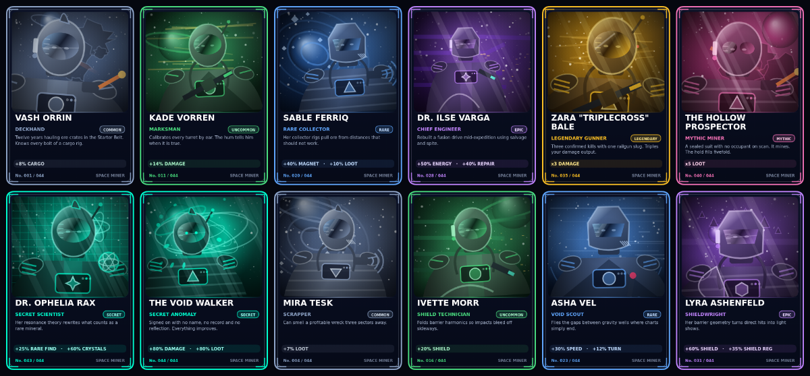
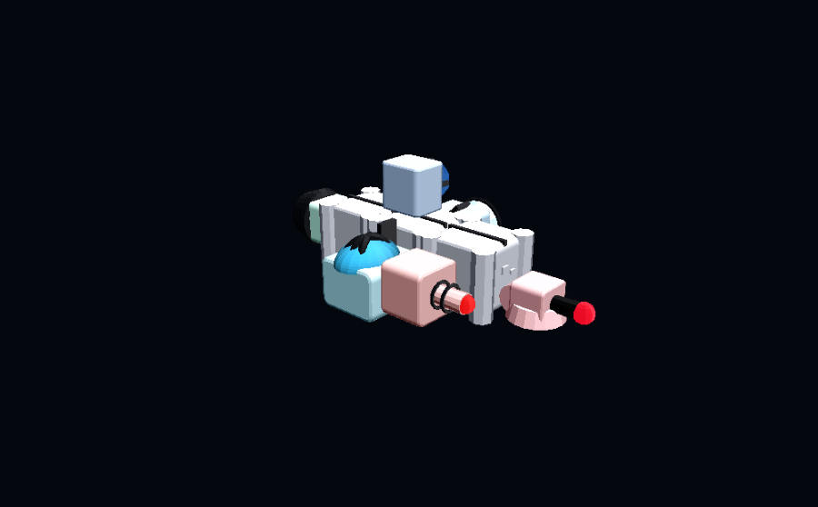
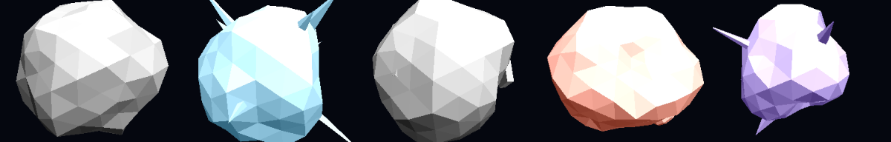
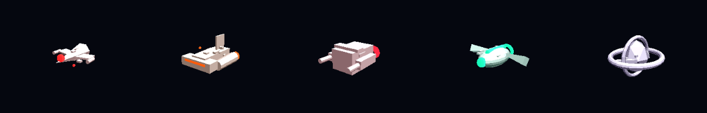
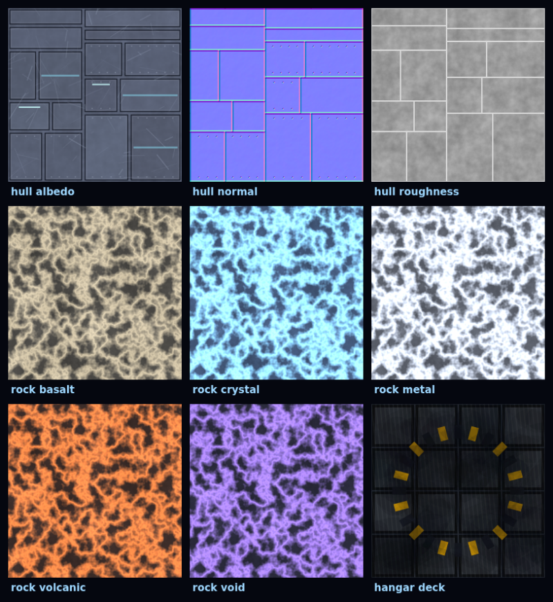

# SPACE MINER: BUILD & CONQUER

A complete 3D space mining, ship-building and combat game for Windows 64-bit.
Build a modular spacecraft bolt by bolt, fly it into five hand-designed sectors, cut ore
out of asteroids, fight hostile drones, recruit a crew of 44 collectible cards and push
deeper into the Void Frontier.



---

## Download (Windows 64-bit)

| Artifact | Description |
| --- | --- |
| **SPACE_MINER_WINDOWS.zip** | Portable build. Unzip, run `SpaceMiner.exe`. |
| **SPACE_MINER_SETUP.exe** | Installer with Start Menu + desktop shortcuts and an uninstaller. |
| **SPACE_MINER_SOURCE.zip** | Full engine project source. |

**Direct downloads (v1.1.0):**

- [SPACE_MINER_WINDOWS.zip](https://github.com/Ritmirchic/Roblox/releases/download/space-miner-v1.1.0/SPACE_MINER_WINDOWS.zip) — portable build
- [SPACE_MINER_SETUP.exe](https://github.com/Ritmirchic/Roblox/releases/download/space-miner-v1.1.0/SPACE_MINER_SETUP.exe) — installer
- [SPACE_MINER_SOURCE.zip](https://github.com/Ritmirchic/Roblox/releases/download/space-miner-v1.1.0/SPACE_MINER_SOURCE.zip) — source archive
- [Release page](https://github.com/Ritmirchic/Roblox/releases/tag/space-miner-v1.1.0) · checksums in `SHA256SUMS.txt`

---

## The game

### Hangar — your orbital foundry
A fully modelled industrial bay: gantry crane on rails, four animated robotic service arms,
hazard-striped launch pad, holographic station pylons with live animated screens, cargo
crates, fuel drums, pipework and scaffolds under moving spotlights. Six terminals open the
shop, builder, crew roster, pack station, upgrade bench and mission board.

### Ship construction — you build the ship, cell by cell
* 3D grid editor with snapping, ghost preview, six module orientations and live validation
  (overlap, out-of-grid, disconnected hull, blocked weapon/engine mounts, single cockpit).
* Expansion cells cost credits, prices scale, and they must physically touch the frame.
* **Every 10 purchased expansion cells unlock exactly 1 crew slot** — `floor(cells / 10)`.
* Live readout of mass, centre of mass (rendered as a gyroscope marker in the editor),
  thrust-to-mass, torque, energy balance, hull integrity, shields, cargo and DPS.
* Placement animations, module removal with hull-splitting protection, persistent layouts.



### 32 functional modules
Structure, command, propulsion, mining, collection, weapons, defense and utility — all of
them do real work in flight:

| Category | Modules |
| --- | --- |
| Mining | Basic / Advanced Mining Laser, Plasma Drill, Crystal Extractor, Heavy Mining Beam |
| Collection | Magnetic Collector, Advanced Magnet, Vacuum Collector, Wide-Range Collector |
| Weapons | Machine Gun, Laser Cannon, Plasma Cannon, Rocket Launcher, Missile Battery, Railgun |
| Defense | Shield Generator, Reinforced Armor, Repair Module, Defensive Drone Bay |
| Utility | Radar, Resource Scanner, Energy Generator, Cargo Expansion, Thruster Booster |
| Propulsion | Ion Thruster, Fusion Drive, Vector Manoeuvre Pod, Warp Core Thruster |

Engines push from their real mount points, turrets rotate and lead their targets, rockets
fly as physical projectiles, missiles home, magnets drag ore chunks into the hold, shields
absorb damage before the hull, and individual modules take damage and lose efficiency.

### Expeditions — five sectors
Starter Belt · Crystal Nebula · Iron Graveyard · Plasma Storm · Void Frontier.
Each sector has its own asteroid style, lighting, nebula backdrop, resource table, hazard
(debris, arc lightning, gravity anomalies) and enemy mix.




### Crew cards and packs
44 unique cards across seven rarities (Common → Secret), each with an original procedurally
painted portrait, collection number, written bio and a real aggregated bonus (x3 damage,
x5 loot, x2 speed, +50% energy regen, …). Packs always contain exactly 3 cards, published
odds are computed from the same table used to roll, duplicates convert to crystals, and the
reveal sequence (float → charge → burst → rise → spin → flip → rarity effects) can be
skipped or disabled via reduced-motion settings.

### Achievements
30 live objectives at all times: **5 minute · 3 hourly · 7 daily · 15 weekly**, rotating on
UTC-anchored period boundaries, each one a collectible card with its own illustration,
progress bar and crystal reward. Claims are recorded per period so a reward can never be
claimed twice, and long offline gaps rebuild the slate cleanly.

### Active upgrades
3 slots by default, a 4th purchasable permanently for credits, and a 5th unlocked by a rare
card that drops at exactly **1% per completed expedition**. Maximum 5, duplicates impossible.

---

## Engine and technology

Unreal Engine 5 and Godot 4 were both evaluated first: neither is installed in the build
environment and neither could be fetched (release binaries are not reachable from the
sandbox), so the game is built on a **custom TypeScript + three.js (WebGL 2) engine**,
shipped as a native Windows application.

* **Rendering** — three.js r160, PBR materials, ACES filmic tone mapping, shadow-mapped
  spot/directional lights, pooled additive particle systems, procedural nebula skyboxes.
* **Art** — 100% procedural and generated at runtime: hull plating with panel seams, rivets,
  weld lines and wear; five rock/mineral surfaces; hangar deck plating; animated terminal
  screens; crew card illustrations; achievement art; the application icon. No stock assets,
  no emoji, no untextured placeholders.
* **Geometry** — ship modules, asteroids, wrecks, enemy craft and the hangar are generated
  from merged primitives with bevelled hulls, greebling and style-specific growths.
* **Audio** — fully synthesised with WebAudio (ambient pads, lasers, explosions, UI, card
  reveals). No audio files to download.
* **Windows shell** — a 256 KB native Win64 launcher (`SpaceMiner.exe`, C, cross-compiled
  with Zig) that serves the game from a loopback-only HTTP server and opens it in an
  isolated Chromium app window, falling back to the default browser. GUI subsystem: no
  console, no editor, no engine splash.



---

## Controls

| Context | Keys |
| --- | --- |
| Hangar | drag to orbit · wheel to zoom · click station terminals |
| Builder | select module · `R` rotate · click cell to place · click module to remove |
| Flight | `W/S` thrust · `A/D` strafe · `Space/C` lift · `Q/E` roll · `X` brake · `Shift` boost |
| Combat | mouse to steer · left mouse weapons · right mouse mining lasers · `Esc` return |

---

## Building from source

```bash
npm install
npm run dev            # http://localhost:5173
npm test               # 54 automated tests
npm run build          # production web build in dist/
bash scripts/build-release.sh   # full Windows release pipeline
```

The release pipeline runs the test suite, type-checks, builds the web bundle, generates the
icon, cross-compiles the three Windows binaries with Zig, functionally tests the launcher's
HTTP core, packs the installer payload, verifies it by extracting it with the native
extractor and byte-comparing every file, then emits the three artifacts plus checksums.

### Project layout

```
src/core/      engine loop, input, procedural audio, seeded RNG
src/data/      modules, crew cards, achievements, sectors
src/sim/       ship grid, economy, crew bonuses, packs, achievements, save system
src/render/    procedural textures, module/asteroid/enemy/hangar geometry, VFX, card art
src/scenes/    hangar + ship editor, expedition flight/mining/combat
src/ui/        shell, panels, HUD, pack opening
native/        Windows launcher, installer, uninstaller (C, Zig cross-compiled)
scripts/       tests, icon generation, headless art preview, release pipeline
tests/         54 automated tests
```

## Testing

`npm test` runs 54 assertions covering ship placement/rotation/removal/connectivity, crew
slot maths, mass and centre of mass, thruster physics, crew bonus aggregation, pack odds
(including a 30,000-pack distribution check and the 1% fifth-slot rate over 200,000 rolls),
achievement period rotation and duplicate-claim prevention, save/load round-trips, corrupt
and tampered save recovery, and economy/progression rules.

`npm run smoke` boots the real scene code headlessly and simulates a full expedition —
thrust, mining, chunk spawning, magnet collection, turret fire, enemy AI, HUD telemetry,
payout and save round-trip — so gameplay claims are verified, not assumed.

`npm run preview:art` renders the art pipeline
headlessly (cards, textures, achievements) and software-rasterises the real 3D geometry so
models can be inspected without a GPU — the images in this README come from it.

## License

MIT — see [LICENSE](LICENSE). three.js is MIT licensed, © 2010-2024 three.js authors.
