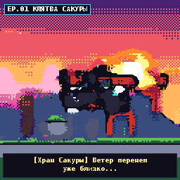
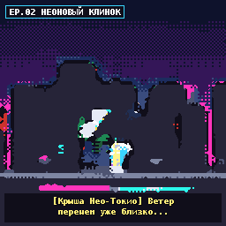
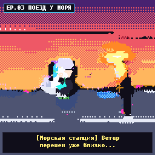
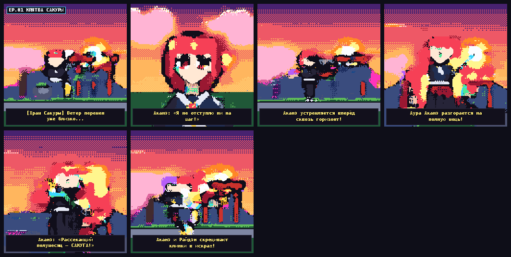
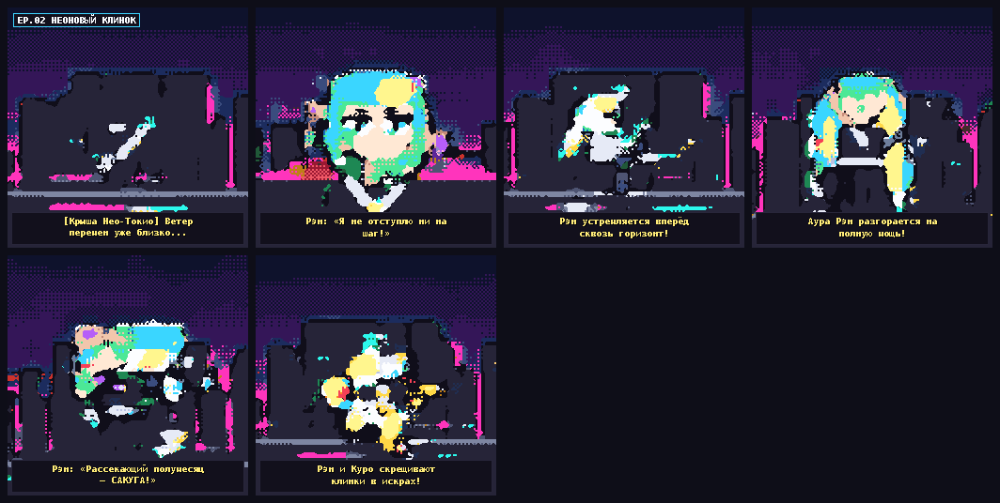
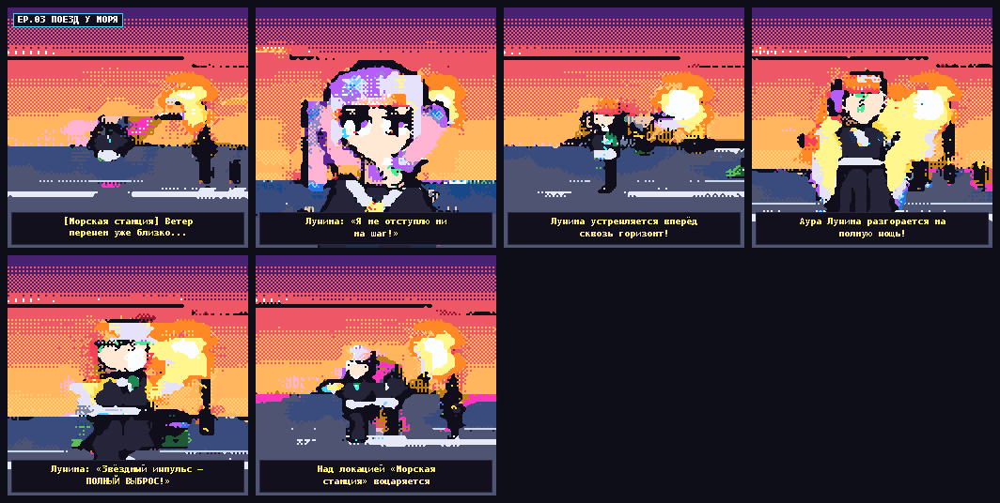

# SAKUGA-256 v2 — Нейросетевой HD генератор пиксель-арт аниме 256×256 с нуля (10.38M параметров)

Полноценная генеративная видео-ИИ система для создания **коротких сцен и длинных многосценовых серий пиксель-арт аниме в разрешении `256×256`**, а также **живого дообучения на конкретных примерах из аниме (GIF / APNG / PNG / JPG / GitHub)** — написанная **полностью с нуля** на C++17 (AVX-512 + OpenMP) и Python без использования PyTorch, TensorFlow, Diffusers или FFmpeg.

---

## Примеры сгенерированных серий v2 (`256×256`, 96 кадров)

| EP.01 КЛЯТВА САКУРЫ | EP.02 НЕОНОВЫЙ КЛИНОК | EP.03 ПОЕЗД У МОРЯ |
| :---: | :---: | :---: |
|  |  |  |
|  |  |  |

---

## Ключевые улучшения архитектуры v2 (`SAKUGA03`)

1. **4× более высокое нативное разрешение (`128×128 → 256×256 Scale2x`)**
   - Вместо грубой сетки `64×64` (v1) автоэнкодер `PixelAnimeVAE` работает напрямую в нативном HD пиксель-арт разрешении **`128×128`** с бесшовной `64×64` пространственной свёрткой и однократным краесохраняющим апскейлом **`1× EPX/Scale2x → 256×256`**.
   - Перцептуально-сбалансированная функция потерь специально усиливает внутренние детали аниме-лица (зрачки, белки глаз, блики, губы и румянец), сохраняя тонкие `1px` контуры без заливки чёрным.

2. **Full-Rank `SakugaDiT` v2 без информационного бутылочного горлышка (`10 376 716` параметров)**
   - Устранён линейный ранк-ботлнек первой версии: размерность трансформера увеличена до **`D = 288 > PATCH_C = 256`**, глубина — до **6 блоков** (`8` голов 3D Axial RoPE внимания на сетке `256` пространственно-временных патчей + `64` токена `z_prev`), а на выходе добавлен **3D пространственно-временной Conv-рефайнер**.
   - Строгий контроль монтажных склеек в `EpisodeDirector`: латент `z_prev` передаётся только между кадрами с одинаковым планом камеры (`Wide → Wide`, `Medium → Medium`), исключая фантомные наложения силуэтов при смене ракурса.

3. **Длительное многофазное обучение (`2 240` шагов VAE + `3 800` шагов DiT)**
   - Обучен на полном наборе конкретных аниме-сцен и переходов по всем 36 мирам (`6 героев × 6 знаковых аниме-локаций × 4 сюжетные арки`: панорамы, портреты с мимикой и липсинком, пробуждение Ки-ауры, удары катаной, звёздные лучи и дуэли).
   - Шумоустойчивая доводка декодера (`Denoising Latent Regularization`) согласована с непрерывными траекториями `Heun ODE`, а `FM_MSE` доведён до **`0.0439`** (попиксельная zero-shot точность на `128×128` — **`83.72%`**).

4. **Импортер и живое обучение на ваших конкретных примерах аниме (`sakuga_ai/reference_importer.py`)**
   - Загружайте любые анимированные `.gif` / `.apng` / `.webp`, горизонтальные спрайт-листы или отдельные кадры `.png` / `.jpg` (а также прямые ссылки на `github.com`) через веб-студию или Python API — движок квантизует их в 48-цветную палитру `128×128` и дообучает `PixelAnimeVAE + SakugaDiT` прямо на ваших референсах!

---

## Быстрый старт

```bash
# 1. Сборка C++17 AVX-512 движка (bin/libsakuga.so)
make

# 2. Автотесты градиентов, импортера референсов и медиа-кодеков
/home/user/.venv/bin/python -u tests/test_grad_and_pipeline.py

# 3. Запуск интерактивной веб-студии SAKUGA-256 v2
/home/user/.venv/bin/uvicorn web.server:app --host 0.0.0.0 --port 8000

# 4. Дообучение или переобучение модели (--resume продолжает с чекпоинта)
/home/user/.venv/bin/python -u -m sakuga_ai.train_pipeline --pairs 140 --vae-steps 480 --dit-steps 1600 --resume
```
